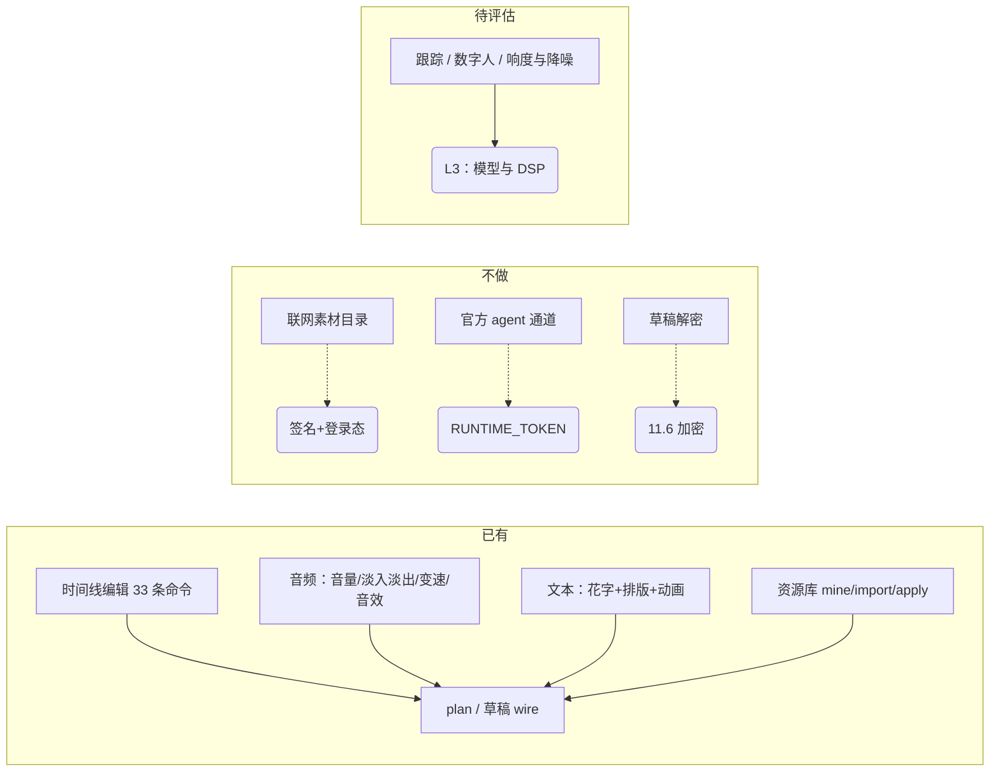

# 剪映专业版 11.6.0.14552 功能与界面参考

本文件是**参考记录**，不是承诺清单：用来把"界面上看到的能力"映射到插件当前的支持状态，
并明确哪些被有意排除。所有结论标注来源；未验证的一律写"未验证"。

采集环境：Windows，`C:\Users\hnxyh\AppData\Local\JianyingPro\Apps\11.6.0.14552`，
安装版 11.6.0.14552（注册表卸载项为唯一命中，未安装抖音桌面端）。

## 1. 应用构成（静态观察）

| 层 | 证据 |
|---|---|
| 宿主外壳 | Qt6（`Qt6Quick.dll`/`Qt6Qml.dll`）+ CEF（`cef/`、`CefCreator.dll`）+ Lynx（`lynx.dll`、`lynx_core.js`） |
| 原生能力 | `cccreator.dll`(158 MB)、`VECreator.dll`(272 MB)、`videoeditor.dll`(72 MB)、`audioeffect.dll`、`EffectPlatform.dll`、`res_pool.dll`、`resourcecli.dll` |
| 前端资源 | `Resources/` 下 21 个 Lynx 面板、多个 H5 应用（`image_h5_*`、`export_publish`、`canvas_agent`） |
| 官方 agent | `jianying-agent-cli.exe`（`draft query-content/plan-patch/validate-patch/apply-patch`）、`Resources/canvas_agent/runtime/app-server.mjs`、`agent_runtime_addon.node` |
| 资源服务 | `resourcecli.dll` 明文串：`https://lv-pc-api.ulikecam.com`、`https://lv-api.ulikecam.com`、`https://lv-biz-api.ulikecam.com`、`https://effect.snssdk.com` |

## 2. REA（morluto/rea 6.7.0）分析结果

命令与结论（可复现）：

```bash
# 1) 整包概览 —— 失败，且有明确原因
npx -y rea-agents@latest analyze "<安装目录>" --json
# → code=resource_constraint
#   worker_old_space_mb=1024, worker_heap_limit_bytes=1 098 907 648,
#   parent_result_budget_bytes=2 019 990 884, exhausted=true
#   在 1238/1431 个 JavaScript/JSON 工件处停止

# 2) 单应用（AI 画布）—— 成功，但覆盖为 partial
npx -y rea-agents@latest analyze-javascript-application "<安装目录>\Resources\canvas_agent" --json
```

第 2 条的实际产出：

- `evidence_id = ev_c0b7e0fc931eaa253614d13028ea6e81fde4b02b029f875bd14d7f7d3353b77a`
- 图规模：**3325 节点 / 6897 边**；`coverage.status = "partial"`
- 节点种类：`javascript-module` 1907、`javascript-asset` 414、`unknown` 823、
  `artifact` 58、`source-module` 40、`package` 26、`endpoint` 29、`javascript-chunk` 14、
  `source-map` 11、`storage` 2、`electron-renderer` 1
- `summary`：`browser_windows=0`、`context_bridge_apis=0`、`ipc.operations=0`
  → 该目录是 **Web/H5 侧**，不是 Electron 主进程，IPC 相关事实为空属正常
- `limitations`：831 条，其中 **822 条是 resource constraint**（后续文件的语义分析未开始）
- 观察到的路由（`endpoint` 节点，`mechanism: property:path`）：
  - `/api/custom-agent/canvas-drafts/v2/logs/reveal`
  - `/api/custom-agent/diagnostics/material-understanding/clear-cache`
  - `/.custom-agent/generation-spec-debug`

**结论**：REA 能给出真实的应用图与证据链，但默认内存预算（1 GB worker / 2 GB result）
不足以覆盖 1431 个工件的整包分析；需要按子应用分批跑，或提高 `NODE_OPTIONS` 堆上限。

## 3. 界面能力清单（以用户提供的两张面板截图为准）

### 3.1 音频面板（右侧属性栏）

| 界面项 | 插件状态 |
|---|---|
| 音量 | ✅ `timeline volume` + plan `volume` |
| 淡入 / 淡出时长 | ✅ `timeline audio-fade` + plan `fade` |
| 变速 | ✅ `timeline speed` |
| 换音色 / 声音效果 / 改编翻唱（音效挂载） | ✅ `timeline audio-effect`（场景音效 / 音色 / 声音成曲） |
| 响度统一 / 音频降噪 / 人声美化 / 声音分离 / 立体声平衡 / 声道配置 / 音频翻译 | ❌ 未实现（DSP 与联网能力，L3 范围外） |
| 变调 | ✅ `timeline pitch on\|off` → 片段 `is_tone_modify`；与计划 `change_pitch` 同义 |
| 变声参数（音高偏移 / 音色 / 强度） | ⚠️ `timeline audio-effect-param --params` 改已挂载音效的 `audio_adjust_params[].value`（目录 0-1，UI 0-100）；真实编辑器听感验收待补 |
| 音乐库 / 音效库（左侧素材库：热门/最新/纯音乐/旅行/轻快/恋爱旋律/K-POP/卡点/治愈/国风/AI 音乐） | ❌ 联网目录，插件不做抓取；改由 `resource mine/import/apply` 复用用户自己的素材 |

### 3.2 文本面板（花字）

| 界面项 | 插件状态 |
|---|---|
| 花字 / 气泡 | ✅ plan `text_effect` / `bubble`（raw ids）+ `resource apply --kind text_shape` |
| 字体 / 字号 / 颜色 | ✅ plan `font` / `size` / `color` |
| B / I / U 样式 | ✅ plan `bold` / `italic` / `underline` |
| 字间距 / 行间距 | ✅ plan `letter_spacing` / `line_spacing`（`×0.05`、`0.02+×0.05`，与 pyJYD 一致） |
| 对齐方式 | ✅ plan `alignment` |
| 预设样式（背景 / 阴影） | ✅ plan `background` / `shadow` |
| 缩放 / 等比缩放 / 位置 / 平面旋转 | ✅ plan `scale` / `x` / `y` / `rotation`；关键帧 11 通道 |
| 混合 / 不透明度 | ✅ `mix_mode` / `timeline composite`；plan `opacity` |
| 文本动画 | ✅ plan `animation_in/out/group` |
| 跟踪（人脸/物体跟踪） | ❌ 未实现 |
| 朗读（TTS） | ✅ `media tts`（本地/HTTP/云厂商适配器） |
| 数字人 | ❌ 未实现（`Resources/digital_human` 为闭源模型资产） |

### 3.3 其他界面（Lynx 面板 + H5 应用，静态枚举）

`Resources/lynx_config/` 下 21 个面板全部是**商业化与活动**方向，不含剪辑主界面：
`commerce_vas_*`（会员/权益/退款/发票/额度）、`credits_*`、`activity`、`hot_activity`、
`message_center`、`redeem`、`refund`、`global`、`modal` 等。

`Resources/canvas_agent/skills/` 暴露剪映 11.6 的 AI 功能面（19 个技能目录）：

| 技能 | 含义 |
|---|---|
| `studio.edit.speaker_cut` | 智能剪口播（Clean Cut 去水词/停顿/重复） |
| `audio-rhythm` / `audio-voice-first` | 音乐卡点 / 口播优先编排 |
| `aigc-film-assets` / `aigc-text-to-singlefilm-v2` | 图文成片 / 素材生成 |
| `script-logic` / `brand-guidelines` / `platform-adaptation` | 脚本结构 / 品牌规范 / 平台适配（抖音 9:16、B站 16:9、小红书 3:4） |
| `canvas-cli` / `hub-cli` / `editing-review` | 画布与草稿 CLI、编辑评审 |
| `jianying.hub.studio_lyria_xml_timeline_builder_v2` | XML 草稿编排（对应 `packaged-skills.json` 中的"XML 草稿编排"） |
| `jianying.hub.studio_edit_reference_recall_v2` | 参考素材召回 |
| `lark-doc` / `lark-shared` / `skill-creator` / `grid-image-generation` | 文档、技能脚手架、九宫格出图 |

`Resources/canvas_agent/prompts/`：`director-agent-fornax-sp.md`、`editing-agent-fornax-sp.md`、
`editing-agent-legacy-sp.md`、`script-agent-fornax-sp.md` —— 导演/剪辑/脚本三类智能体提示。

## 4. 对插件的直接结论



1. **界面上的"素材"是联网目录**，本地无清单；插件用 `resource` 命令族复用用户真实用过的素材，
   这是当前唯一可持续、可测试的路径。
2. **官方 agent 通道存在但被令牌门控**（`JIANYING_AGENT_RUNTIME_TOKEN`）；只保留适配位。
3. **11.6 保存的草稿加密**，`resource mine` 会如实报告 `drafts_encrypted` 而不解密。
4. 截图中仍有明确缺口可做，且不涉及联网/鉴权：**跟踪**、**变调命令**、**音量关键帧的编辑命令**
   （plan 已有）、以及**素材库的可视化前端**（在插件侧做，不动客户端）。

## 5. 复现命令

```bash
# 应用构成
ls "<安装目录>/Resources/lynx_config"
cat "<安装目录>/Resources/canvas_agent/packaged-skills.json"

# 官方 agent CLI 的权限门控（只读探测）
"<安装目录>/jianying-agent-cli.exe" draft query-content --input empty.json
# → {"code":"PERMISSION_DENIED","message":"JIANYING_AGENT_RUNTIME_TOKEN is required"}

# REA（需 Node 24+）
npx -y rea-agents@latest analyze-javascript-application "<安装目录>/Resources/canvas_agent" --json
```
