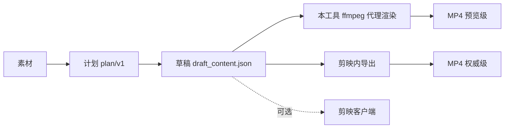

# 目标态：无客户端智能剪辑

这份文档把"最终要变成什么"写成可验收的条目，并给出每一项的**当前证据**。
凡是没跑过的，一律标注"未验证"；凡是做不到的，直接写进"边界"。

## 1. 六条验收条目

| # | 用户要求 | 可观测的验收方式 |
|---|---|---|
| V1 | 完全替代 pyJianYingDraft | pyJYD 的 API/字段映射 `uncovered=0`；55 个双源场景 55/55；运行时零 Python 依赖 |
| V2 | 具备 dream-loop 的设计思想 | 生成-评估-修正的闭环可运行，且每轮有可复核的指标与停止条件 |
| V3 | 具备 hypit 的设计思想 | 计划层可被程序化改写/组合，且改动可解释、可回滚 |
| V4 | 整合 jianying-editor-skill | 技能以可调用命令/工具形式暴露，有调用契约与失败语义 |
| V5 | 整合 jianying-headless 能力 | 无需交互式客户端即可批量出片（渲染、字幕、素材处理） |
| V6 | **没有剪映客户端也能完成智能剪辑** | 一条命令从"素材 + 意图"产出成片文件，全程不启动剪映 |

## 2. "无客户端"的准确边界

客户端在三个位置可能被需要，必须分开看：



- **构建与编辑**：不需要客户端（纯文件读写 + 结构校验）。✅ 已实现
- **预览出片**：不需要客户端，用 ffmpeg 平铺主轨 + 混音 + 可选烧字幕。✅ 已实现（**预览级**）
- **权威导出**：仍需要客户端。⚠️ 明确不承诺

`render proxy` 自述的边界是"不含转场/特效/蒙版；权威出口是剪映内导出"。这条边界是设计选择，
不是缺陷——把预览级渲染伪装成权威导出才是缺陷。

## 3. 端到端实测（无客户端）

```
素材：ffmpeg 生成 3s 640x360 h264 + 3s aac
计划：video(0-3s) + text("无客户端出片")
命令：project build → render proxy
结果：preview.mp4 = h264 320x180 / 3.000000s / 3975 bytes / 0.15s
```

`render proxy` 返回：`video_tracks_flattened=1`、`audio_segments_mixed=0`（该计划无音轨）、
`captions_burned=0`、`target_fps=30`。全过程未启动剪映。

复现：

```bash
ffmpeg -f lavfi -i color=c=0x1E90FF:s=640x360:d=3 -f lavfi -i sine=frequency=440:duration=3 \
       -c:v libx264 -pix_fmt yuv420p -c:a aac -shortest clip.mp4
jianying project build plan.json --out draft --json
jianying render proxy draft --out preview.mp4 --json
ffprobe -v error -show_entries format=duration:stream=codec_name,width,height -of json preview.mp4
```

## 4. 六根支柱现状矩阵

| 支柱 | 现状 | 证据 |
|---|---|---|
| V1 pyJYD 替代 | 🟡 核心达成：55/55、catalogs 与 SOURCE_MANIFEST 同锚、单一 writer 覆盖 speed/volume/opacity/keyframe 别名；**未完成**：API 面清单、剩余 op 迁移 | `provenance/PARITY_RUN.json`、`tests/path_equivalence.rs`、`src/writer.rs` |
| V2 dream-loop 闭环 | 🟡 闭环已可运行：`eval` 给 0–100 确定性评分 + 结构化问题，`loop` 按问题挑安全修复并重评（最大轮数、显式停止原因）；**缺**内容级生成与更丰富的修复集 | `src/eval_ops.rs`、`tests/eval_loop_contract.rs` |
| V3 hypit 计划层 | 🟡 `plan/v1` 可程序化生成/改写，`timeline` 33 条命令可增量修改；缺"计划级组合与回滚语义" | `docs/plan-format.md`、`src/plan.rs` |
| V4 editor-skill 整合 | 🟡 已建**技能注册表**：14 条工作流技能带状态/意图/命令/缺口，且合同测试校验引用命令真实存在；缺口以 `partial`/`missing` 显式登记 | `src/skills.rs`、`tests/skills_contract.rs`、`jianying skills list` |
| V5 headless 能力 | 🟡 探针/ASR/TTS/渲染/字幕/资源库齐备，缺批处理编排与"多片一次出"的验收 | `src/render.rs`、`media asr|tts`、`tests/render_batch_contract.rs` |
| V6 无客户端出片 | 🟢 **预览级已通**（§3 实测）；权威导出明确不做 | 本文 §3 |

图例：🟢 已达成 / 🟡 部分 / 🔴 未开始。

## 5. 已知阻塞与决定

| 项 | 状态 | 说明 |
|---|---|---|
| `speed_curve`（曲线变速） | **阻塞** | pyJYD 只写 `curve_speed: null`，没有格式参考；剪映 11.6 草稿加密，拿不到真实样本。不做猜测实现 |
| `compound/member`（复合片段） | **阻塞** | 同上，缺明文样本 |
| 草稿解密 | **不做** | 属客户端保护机制，越界 |
| 联网素材目录 | **不做** | 需签名与登录态；改由 `resource mine/import/apply` 复用用户素材 |
| 官方 agent 通道 | **只留适配位** | 需 `JIANYING_AGENT_RUNTIME_TOKEN`，不自取令牌 |

## 6. 下一步（按价值排序）

1. **V2 闭环**：定义 `eval` 指标（时长/黑帧/响度/字幕覆盖率）+ `loop` 命令（生成→评估→修正，带停止条件与审计）。这是"智能"二字的落点。
2. **V4 技能整合**：把 `docs/reference` §3.3 的 19 个技能映射为插件内的可调用能力声明，缺的标 `partial`。
3. **V5 批处理**：`render batch` 已有，补一条"多片一次出 + 汇总验收"的端到端用例。
4. **V1 收尾**：pyJYD API 面清单（`uncovered=0` 的可计算版本）。

> 说明：本文的"未验证"指没有在本仓库留下可复现命令与输出的结论。

## 7. 评估-修正闭环实测（2026-10-18）

```
project build（两段连续主轨）→ eval              → score 100, issues []
timeline move 第二段 +2.5s      → eval              → score 62, issues [main-track-gap], gap_us 2.5s
                                → loop --min-score 100
                                  round 1: close-main-track-gaps  62 → 100
                                  final: score 100, gap_us 0, stopped "clean"
```

`eval` 前后 `draft_content.json` 字节一致（只读）；`loop` 的每次修复都走事务
（快照 → 校验 → 原子提交），失败不会留下半成品。